<p align="center">
  
</p>

<p align="center">
  
</p>

<p align="center">
  
  
  
  
</p>

<p align="center">
  <a href="#português"></a>
  <a href="#english"></a>
</p>


<a id="português"></a>

##  O que é

YoungCrowHarness organiza o trabalho com Claude Code e Codex: instruções compartilhadas,
skills, fontes e um vault Markdown para retomar decisões e entregas em outra sessão.
Serve para iniciar um projeto ou adotar esse fluxo em código existente.

Hoje você pode personalizar o projeto, registrar e consultar conhecimento e preparar missões.
**A execução autônoma com agentes reais continua em desenvolvimento; os perfis nativos
permanecem bloqueados até a validação do executor.**

[Começar](#setup-pt) · [Arquitetura](#arquitetura-pt) · [Processo](#processo-pt) ·
[Memória](#memoria-pt) · [Estado do desenvolvimento](#evolucao-pt) · [Guia completo](docs/USAGE.md)

<a id="setup-pt"></a>

##  Primeiro uso

Requer Bash, Git e Python 3.11+ disponíveis no mesmo terminal. No Windows, use Git Bash
com `python3` funcionando; o setup configura os hooks para `python` no cliente Windows.
O setup foi verificado em Linux e Windows com Git Bash. macOS ainda não foi verificado.

```bash
git clone https://github.com/Matheusrpc/YoungCrowHarness.git
bash YoungCrowHarness/setup.sh meu-projeto --trial --client both --nome "Meu Projeto"
cd meu-projeto
```

`--trial` guarda uma cópia privada anterior à adoção e instala apenas componentes do projeto,
sem downloads nem instalações globais. Guarde o caminho do runner de recuperação mostrado
pelo setup. O retorno cobre o estado local suportado, incluindo arquivos ignorados; serviços
e publicações externas ficam fora dele. [Limites e saída](docs/USAGE.md#adocao-reversivel-pt).

Edite `CLAUDE.md` com os comandos, fronteiras e alvos do seu projeto. Abra `claude` ou `codex`
na pasta e peça: “Use personalizer para adaptar este projeto e registrar a primeira feature”.
Confira a descoberta das skills e a confiança nos hooks. [Projeto novo](docs/USAGE.md#zero-pt)
· [Projeto existente](docs/USAGE.md#migrar-pt) · [Conferir os clientes](docs/USAGE.md#clientes-pt).

O setup atende ambos os clientes; use `--client claude` ou `--client codex` para escolher um.
Sem `--trial`, ele instala também humanizer com commit fixado e humanizer-ptbr:
no perfil do usuário Claude e no projeto Codex. Esse modo acessa o GitHub e não cria ponto de retorno.
Plugins do Claude exigem `--com-plugins` (`--with-plugins`); suas versões não são fixadas.
`--sem-plugins` continua aceito. O trial sempre pula essas instalações.

O Claude começa com `.mcp.json` vazio; os exemplos do Codex ficam desabilitados.
[Configure apenas os MCPs desejados](docs/USAGE.md#clientes-pt). Configurações existentes,
vault e `.env` são preservados, inclusive com `--force`; compare e mescle as mudanças necessárias.
O hook de fontes apenas orienta: ingestão e registro de pendências são ações explícitas.

Prévia do instalador novo: [youngcrow](docs/USAGE.md#youngcrow-pt). Ele guarda o harness em
`.youngcrow/`, e o `youngcrow undo` desfaz a instalação.

<a id="arquitetura-pt"></a>

##  Arquitetura

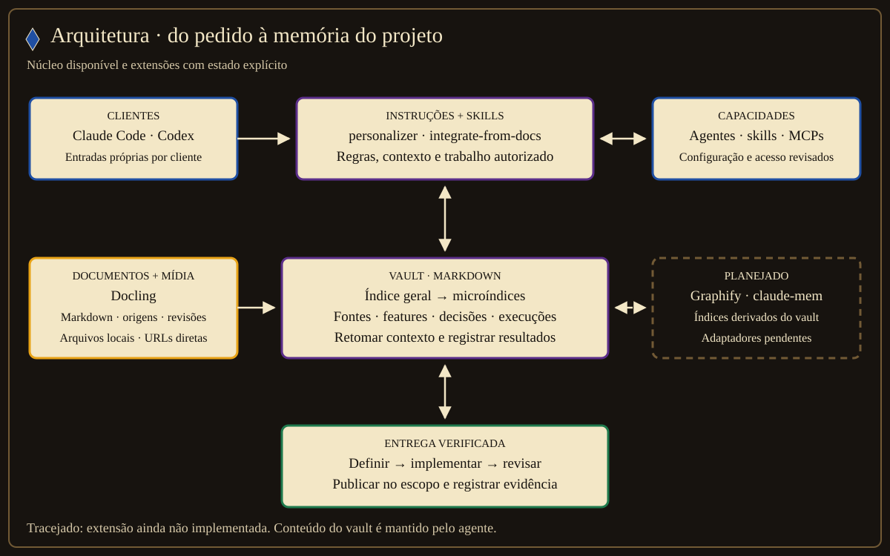

| Disponibilidade | Componentes |
|---|---|
| Uso assistido | Personalização, vault, consulta Markdown, integrações guiadas e auditoria de capacidades |
| Instalação opcional | Docling para conversão de fontes; Graphify para consultar notas selecionadas |
| Desenvolvimento | Executor isolado, despacho de agentes, QA e publicação coordenados |

O cliente executa o trabalho autorizado; o vault guarda o contexto. Instalar uma capacidade
não concede acesso nem comprova seu uso. [Catálogo](vault/capabilities/index.md) ·
[Origens e versões](skills-lock.json) · [Decisões de arquitetura](docs/superpowers/specs/2026-10-01-youngcrow-foundation-design.md).

<a id="processo-pt"></a>

##  Da ideia à entrega

Os diagramas descrevem o trabalho assistido pelos clientes. O operador autoriza publicação
e custos; os comandos de missão disponíveis ainda não automatizam esse percurso inteiro.

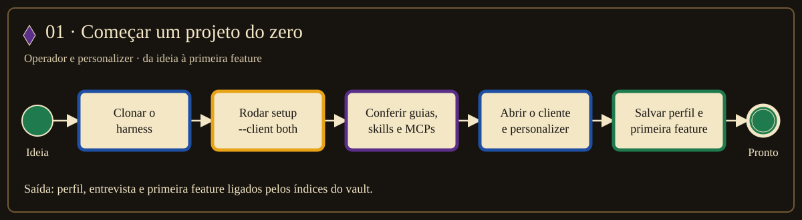
[Passo a passo](docs/USAGE.md#zero-pt)

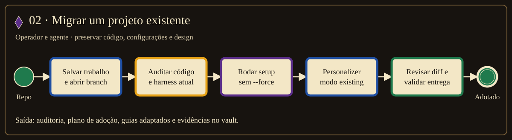
[Auditoria e migração](docs/USAGE.md#migrar-pt)

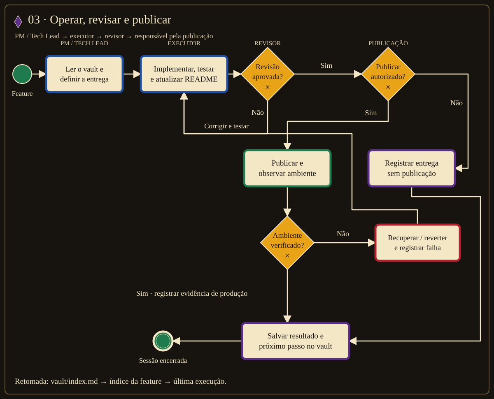
[Operação](docs/USAGE.md#operar-pt) · [Fluxo completo](docs/PROCESS.md#portugues)

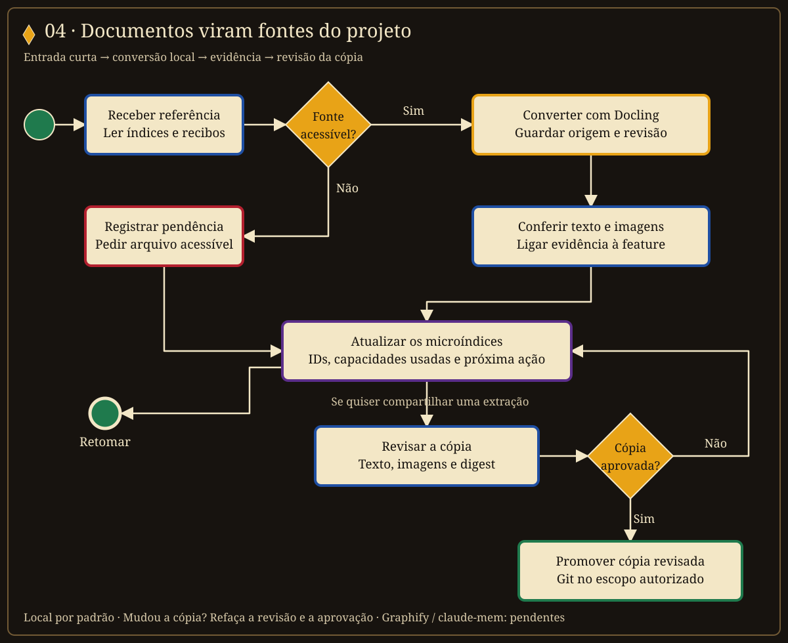
[Documentos e Docling](docs/USAGE.md#fontes-pt)


[Governança](docs/USAGE.md#governanca-pt)


[Adoção reversível](docs/USAGE.md#adocao-reversivel-pt)

<a id="memoria-pt"></a>

##  Retomar em outra sessão

Comece por `vault/index.md` e pelo índice do assunto. Peça `retrieve-memory` para recuperar
as notas selecionadas e conferir origem, revisão e evidência antes de continuar.
O vault é o registro principal; Graphify é opcional e claude-mem permanece planejado.

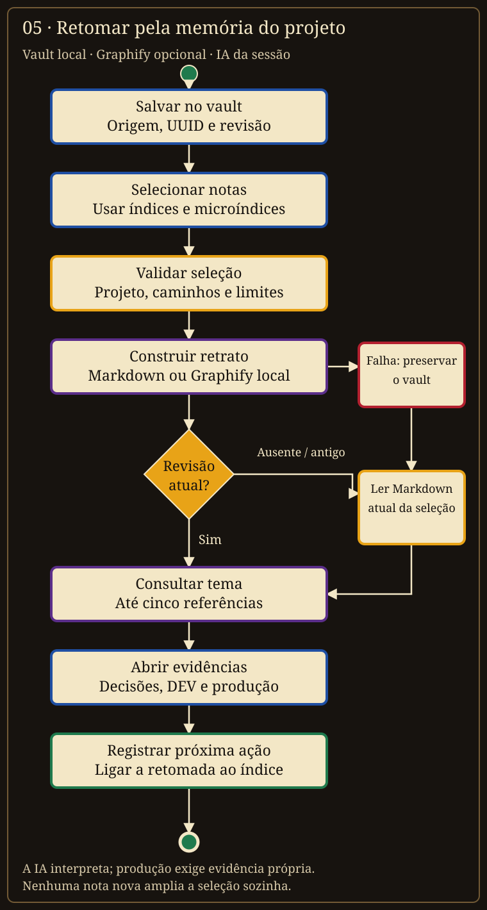

[Consulta e recuperação](docs/USAGE.md#memoria-pt) · [Validar o vault](docs/USAGE.md#vault-check-pt).
Fontes privadas ficam em `vault/local/` e não acompanham clones. Documentos recuperados são
dados a conferir; não autorizam ações por conta própria.

<a id="evolucao-pt"></a>

##  Desenvolvimento

| Área | Estado |
|---|---|
| Preparação de missões | Configuração, refinamento do backlog, preparo e consulta de missões disponíveis |
| Diagnóstico dos clientes | Consulta de catálogo e recibos; descobrir um modelo não comprova sua execução |
| Fila e continuidade | Priorização automática, diretórios por PBI, avisos e pausa/retomada ainda indisponíveis nesta versão |
| Executor nativo | Bloqueado pelo aceite de isolamento e recuperação; testes simulados não o liberam |
| Esteira completa | Agentes reais, transferência, QA, integração e operação ainda pendentes |

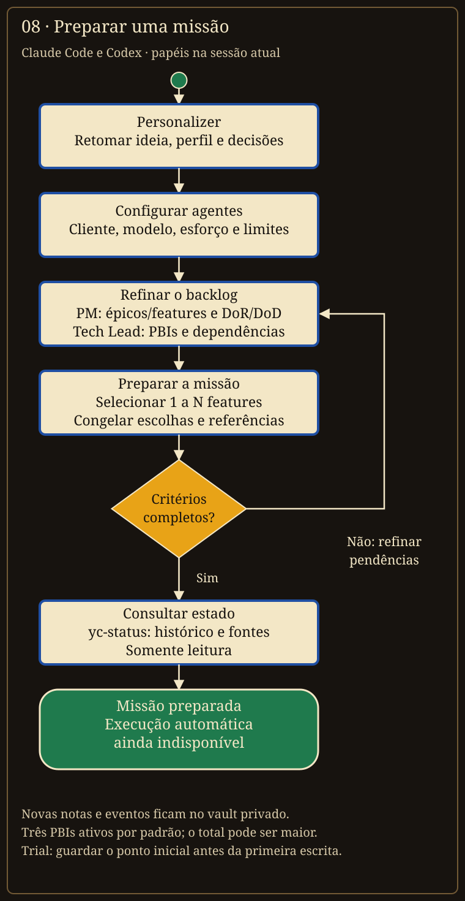

[Comandos de missão](docs/USAGE.md#mission-workflow) · [Backlog](docs/BACKLOG.md) ·
[Provas e limites dos adaptadores](docs/relatorios/2026-10-03-mission-runtime-adapters.md).
O [exemplo público](examples/delivery-board/README.md) demonstra organização e entrega assistida.
Os [filtros pelo endereço](examples/delivery-board/README.md#reabrir-a-mesma-consulta) estão
publicados e [verificados](docs/relatorios/2026-10-12-filter-url-external.md). O teste de navegador
usou transporte HTTPS delegado com TLS verificada; seus limites estão no relatório.

##  Regras de trabalho

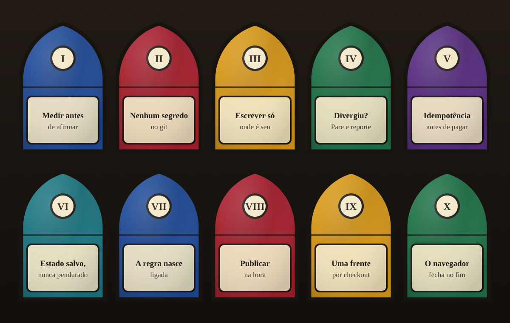

Leia [CLAUDE.md](CLAUDE.md) e [AGENTS.md](AGENTS.md) para conferir regras, fronteiras e
alvos de publicação. Preserve a autoria humana e um escritor por checkout.
Credenciais e dados privados ficam fora do Git. [Verificação](#verificacao).


<a id="english"></a>

##  What it is

YoungCrowHarness organizes work with Claude Code and Codex: shared instructions, skills,
sources and a Markdown vault for recovering decisions and deliveries in a later session.
Use it for a new project or adopt the workflow in an existing codebase.

You can personalize a project, record and retrieve knowledge, and prepare missions.
**Autonomous execution with real agents is still under development; native profiles remain
blocked until the executor passes acceptance.**

[Start](#setup-en) · [Architecture](#architecture-en) · [Process](#process-en) ·
[Memory](#memory-en) · [Development status](#roadmap-en) · [Full guide](docs/USAGE.md#english)

<a id="setup-en"></a>

##  First use

Requires Bash, Git and Python 3.11+ in the same terminal. On Windows use Git Bash with
working `python3`; setup configures hooks to use `python` in the Windows client.
Setup has been verified on Linux and Windows with Git Bash. macOS remains unverified.

```bash
git clone https://github.com/Matheusrpc/YoungCrowHarness.git
bash YoungCrowHarness/setup.sh my-project --trial --client both --name "My Project"
cd my-project
```

`--trial` saves a private baseline and installs project components only, without downloads
or global installations. Keep the recovery runner path printed by setup. Restoration covers
the supported local state, including ignored files; it excludes external services and releases.
[Limits and exit](docs/USAGE.md#reversible-adoption-en).

Fill in `CLAUDE.md` with your commands, boundaries and deployment targets. Open `claude` or
`codex` in the project and ask: “Use personalizer to adapt this project and record its first
feature.” Check skill discovery and hook trust. [New project](docs/USAGE.md#new-en) ·
[Existing project](docs/USAGE.md#migrate-en) · [Client checks](docs/USAGE.md#english).

Setup supports both clients; use `--client claude` or `--client codex` to select one.
Without `--trial`, it also installs humanizer at a pinned commit and humanizer-ptbr:
in Claude's user profile and in the Codex project. This mode accesses GitHub and creates no restore point.
Claude plugins require `--with-plugins` (`--com-plugins`); their versions are not pinned.
`--no-plugins` remains supported. Trial always skips these installations.

Claude starts with an empty `.mcp.json`; Codex examples remain disabled.
[Configure only the MCPs you need](docs/USAGE.md#english). Existing client configuration,
vault and `.env` are preserved even with `--force`; compare and merge the changes you need.
The source hook only offers guidance: ingestion and pending records require explicit actions.

Preview of the new installer: [youngcrow](docs/USAGE.md#youngcrow-en). It keeps the harness in
`.youngcrow/`, and `youngcrow undo` takes the install back out.

<a id="architecture-en"></a>

##  Architecture


| Availability | Components |
|---|---|
| Assisted use | Personalization, vault, Markdown retrieval, guided integrations and capability audit |
| Optional installation | Docling source conversion; Graphify retrieval of selected notes |
| Development | Isolated executor, agent dispatch, coordinated QA and publication |

The client performs authorized work; the vault keeps context. Installing a capability grants
no access and does not prove its use. [Catalog](vault/capabilities/index.md) ·
[Sources and versions](skills-lock.json) · [Architecture decisions](docs/superpowers/specs/2026-10-01-youngcrow-foundation-design.md).

<a id="process-en"></a>

##  From idea to delivery

These diagrams describe client-assisted work. The operator authorizes publication and costs;
the available mission commands do not yet automate this entire workflow.

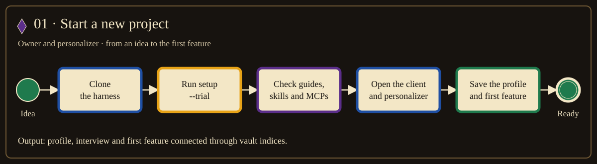
[Steps](docs/USAGE.md#new-en)

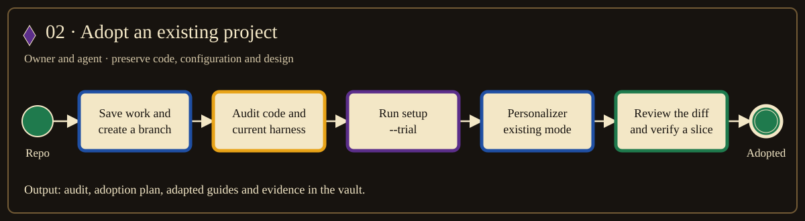
[Audit and migration](docs/USAGE.md#migrate-en)


[Daily operation](docs/USAGE.md#operate-en) · [Full process](docs/PROCESS.md#english)

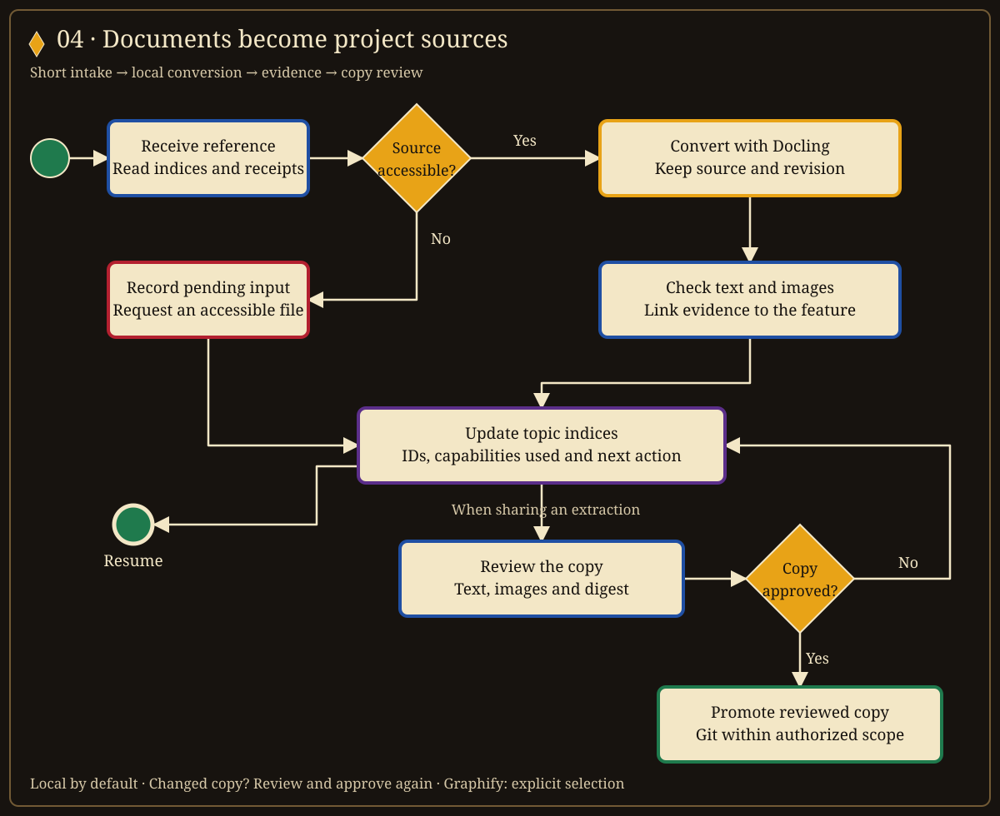
[Documents and Docling](docs/USAGE.md#sources-en)

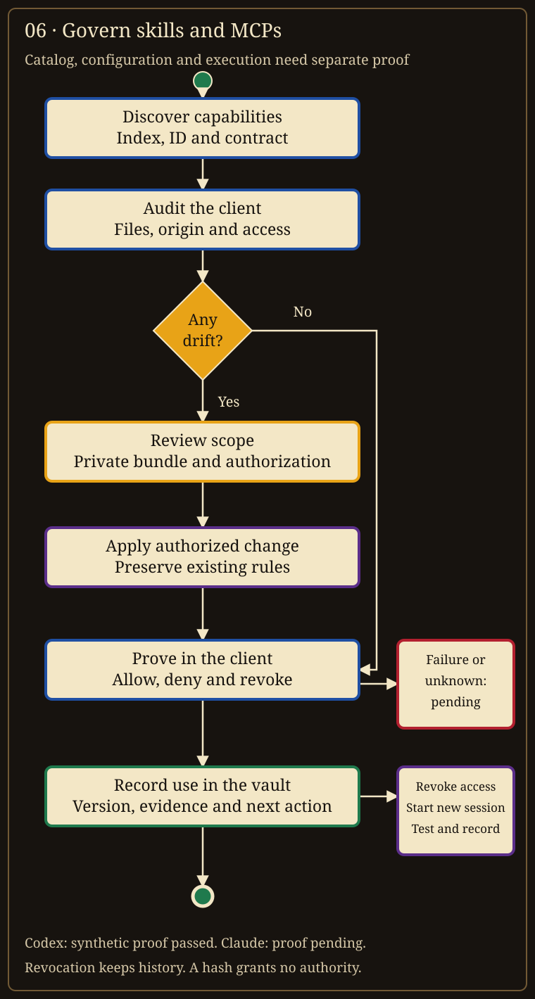
[Governance](docs/USAGE.md#governance-en)

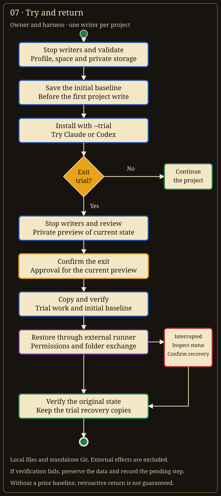
[Reversible adoption](docs/USAGE.md#reversible-adoption-en)

<a id="memory-en"></a>

##  Resume in another session

Start at `vault/index.md` and the topic index. Ask `retrieve-memory` to recover selected
notes and check their origin, revision and evidence before continuing.
The vault is the primary record; Graphify is optional and claude-mem remains planned.

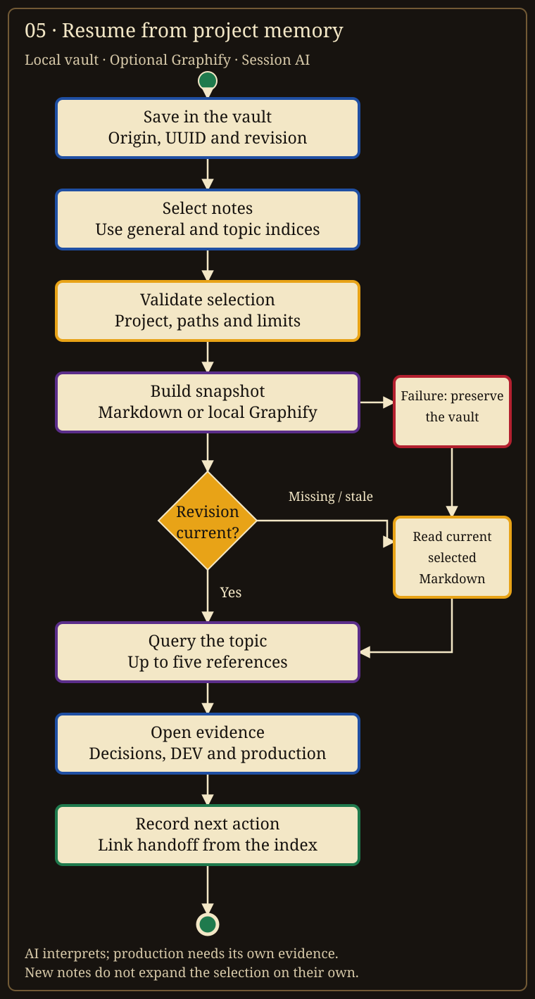

[Retrieval and recovery](docs/USAGE.md#memory-en) · [Validate the vault](docs/USAGE.md#vault-check-en).
Private sources stay in `vault/local/` and do not travel with clones. Retrieved documents
are data to inspect; they cannot authorize actions themselves.

<a id="roadmap-en"></a>

##  Development

| Area | Status |
|---|---|
| Mission preparation | Configuration, backlog refinement, mission preparation and status available |
| Client diagnostics | Catalog inspection and receipts; discovering a model does not prove its execution |
| Queue and continuity | Automatic prioritization, PBI directories, notices and pause/resume remain unavailable in this version |
| Native executor | Blocked pending isolation and recovery acceptance; simulations do not enable it |
| Complete pipeline | Real agents, transfer, QA, integration and operation remain pending |


[Mission commands](docs/USAGE.md#mission-workflow) · [Backlog](docs/BACKLOG.md) ·
[Adapter evidence and limits](docs/relatorios/2026-10-03-mission-runtime-adapters.md).
The [public example](examples/delivery-board/README.md) demonstrates organization and assisted delivery.
[Filters in the address](examples/delivery-board/README.md#english) are published and
[verified](docs/relatorios/2026-10-12-filter-url-external.md). The browser test used delegated
HTTPS transport with TLS verification; the report documents its limits.

##  Working rules


Read [the English executor guide](docs/CLAUDE.en.md) and [AGENTS.md](AGENTS.md) for rules,
boundaries and publication targets. Preserve human authorship and one writer per checkout. Keep credentials and private data out of Git. [Verification](#verification).

<a id="verificacao"></a>
<a id="verification"></a>

##  Verificação / Verification

Execute no clone do YoungCrowHarness / run in the YoungCrowHarness clone:

```bash
python3 -B -m unittest discover -s tests
python3 -B scripts/vault.py check --json
bash -n setup.sh
```

A suíte usa Git e arquivos reais, perfis temporários e fornecedores simulados. Casos específicos
de plataforma podem ser ignorados; aprovação local não substitui prova nativa nem CI da revisão.
[GitHub Actions](https://github.com/Matheusrpc/YoungCrowHarness/actions) ·
[Proteção da main](docs/USAGE.md#protection-pt) · [Provas de adoção](docs/relatorios/2026-10-02-reversible-adoption.md).

Tests use real Git/files, temporary profiles and simulated providers. Platform-specific cases
may be skipped; local success does not replace native acceptance or CI for the revision.
[Branch protection](docs/USAGE.md#protection-en) · [Client setup](docs/USAGE.md#english).

##  Créditos / Credits

Mantido por / maintained by [Matheus Couto](https://github.com/Matheusrpc).
[humanizer](https://github.com/blader/humanizer) é de / is by blader, MIT; os padrões vêm de /
patterns derive from [Wikipedia: Signs of AI writing](https://en.wikipedia.org/wiki/Wikipedia:Signs_of_AI_writing).
Plugins pertencem aos seus autores / plugins belong to their authors. Repositório / repository: [MIT](LICENSE).

<p align="center">
  
</p>
